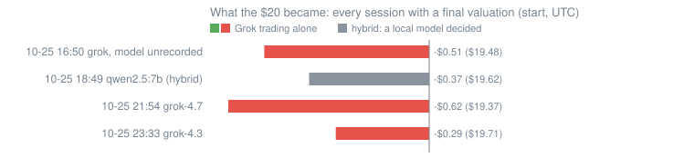
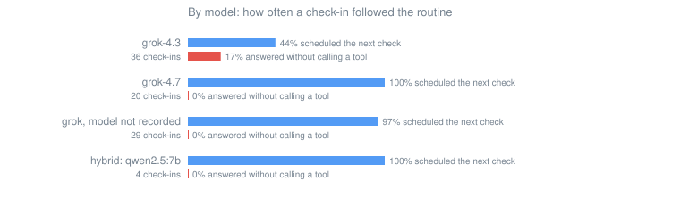
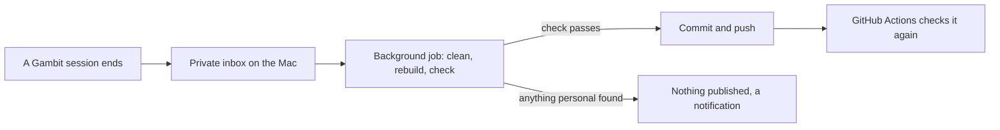

# Grok Trading Research

<!-- badges:start -->
   
<!-- badges:end -->

**Can Grok, trading alone with $20, make a profit?**

Grok is given a $20 paper account in Gambit, a private macOS app, and left to trade it. Grok picks the coins, sizes each trade, sets the stops and decides when to look again. Nobody tells Grok what to buy. Paper means the money is simulated but the prices are not: every buy and sell fills at a live Jupiter quote for that exact trade.

This repository publishes everything those sessions produce, and keeps one running answer to the question.

## The answer so far

<!-- answer:start -->
### So far: **no**

Grok has traded alone, from a fresh $20, to the end of 3 sessions. None finished above where it started.

| Session (UTC) | Model | Kind | Start | End | Result |
|---|---|---|---:|---:|---:|
| 2026-10-25 16:50 | not recorded | training | $19.99 | $19.48 | -$0.51 (-2.5%) |
| 2026-10-25 21:54 | grok-4.7 | training | $19.99 | $19.37 | -$0.62 (-3.1%) |
| 2026-10-25 23:33 | grok-4.3 | overnight | $19.99 | $19.71 | -$0.29 (-1.4%) |
| **All 3** | | | **$59.98** | **$58.56** | **-$1.41 (-2.4%)** |

Positions Grok closed while trading alone: 9. 4 made money (+$3.48, +$0.87 on average). 5 lost (-$4.43, -$0.89 on average). Net: -$0.95.

Not counted in the answer: 5 Grok sessions stopped before a final valuation, and 2 hybrid sessions where a small local model made the decisions. All of them are in the data.

_Updates itself with every session. Latest: 2026-10-26 09:33 UTC._


<!-- answer:end -->

## What we've learned so far

1. **Wins and losses are about the same size, and losses come more often.** Of the 9 positions Grok closed while trading alone, 4 made money, $0.87 on average, and 5 lost, $0.89 on average. To come out ahead, Grok needs either more winners or bigger ones.
2. **One early buy undid the best trade.** In the same session, LAUNCH made $3.14, the best result so far, and X, bought 59 minutes after it left its launch curve, lost $2.97 in about three minutes.
3. **A price feed can print a price that never traded, and a stop will believe it.** The overnight session's first trade was sold by its stop on a price 19% below the coin's only pool. The coin then rose past its take-profit. Without that app bug, the overnight session would most likely have finished about +$0.15, Grok's first session in profit. See the [incident report](reports/2026-10-26-false-stop-loss.md). The app now checks the real sell quote before any stop sells.
4. **A rule built from two trades can freeze a trader.** The app's coach compared one winner (LAUNCH, +$3.14) with one loser (X, −$2.97) and wrote an entry rule from them. Over later sessions it grew to four conditions: an organic score of 75 or more, liquidity 100% locked, mint and freeze revoked, and net buying over the last 5 minutes. Overnight, it kept Grok from buying anything for 8 of its 10 hours.
5. **grok-4.3 skipped steps that grok-4.7 didn't.** grok-4.3 forgot to schedule its next check in 20 of 36 check-ins, where grok-4.7 forgot in 0 of 20. Six times it called no tool at all and still reported that no candidate qualified, repeating its own notes.
6. **Drills are easier than markets.** Grok passed 55 of 58 scripted drills (a planted scam, a rug pull, a missing stop), yet none of the sessions it traded alone to the end made money.

## Special reports

| Date | Report |
|---|---|
| 2026-10-26 | [Overnight: grok-4.3 alone with $20 for ten hours](reports/2026-10-26-overnight-grok-4.3.md) |
| 2026-10-26 | [Incident: a stop-loss fired on a price that never traded](reports/2026-10-26-false-stop-loss.md) |
| 2026-10-25 | [Training day: drills, a coach and nine sessions](reports/2026-10-25-training-day.md) |

## By model

<!-- models:start -->
| Setup | Model | Sessions | With a final valuation | Their result | Check-ins | Scheduled the next check | Answered with no tool call | Drills passed |
|---|---|---:|---:|---:|---:|---:|---:|---:|
| grok | grok-4.3 | 1 | 1 | -$0.29 | 36 | 44% | 17% | none run |
| grok | grok-4.7 | 3 | 1 | -$0.62 | 20 | 100% | 0% | 26 / 26 |
| grok | not recorded | 4 | 1 | -$0.51 | 29 | 97% | 0% | 29 / 32 |
| hybrid | qwen2.5:7b | 2 | 1 | -$0.37 | 4 | 100% | 0% | none run |


<!-- models:end -->

## The data

| File | One row per |
|---|---|
| [`data/sessions.csv`](data/sessions.csv) | session: model, bankroll at the start and the end, result, trades, drills |
| [`data/checkins.csv`](data/checkins.csv) | check-in: tools called, whether it traded or scheduled the next check, Grok's summary |
| [`data/tool_calls.csv`](data/tool_calls.csv) | tool call: name, arguments, errors |
| [`data/trades.csv`](data/trades.csv) | buy or sell Grok made: amounts, price impact, its stated reason |
| [`data/closed_trades.csv`](data/closed_trades.csv) | closed position: realized result and how it was closed |
| [`data/drills.csv`](data/drills.csv) | drill result |
| [`data/mistakes.csv`](data/mistakes.csv) | mistake the app flagged |
| [`data/sessions/`](data/sessions) | session in full (JSON): every tool call with its output |

Field descriptions are in [`DATA.md`](DATA.md) and in [`data/datapackage.json`](data/datapackage.json) (a [Frictionless](https://specs.frictionlessdata.io/data-package/) descriptor). To load a table:

```python
import pandas as pd

base = "https://raw.githubusercontent.com/Myrhex-x/Grok-Trading-Research/main/data/"
sessions = pd.read_csv(base + "sessions.csv")
alone = sessions[(sessions.setup == "grok") & sessions.complete]
print(alone[["id", "model", "start_value_usd", "end_value_usd", "paper_pnl_usd"]])
```

## How the experiment works

[`METHODOLOGY.md`](METHODOLOGY.md) has the full setup: the app, how paper fills are priced, the tools Grok has, the guardrails, the drills, the mistake checker and the coach, and what the setup can't tell you.

## How this repository updates itself



The raw reports never leave the Mac. The job publishes a session once it has finished. Before publishing, it strips anything personal:

- Every X account becomes a stable stand-in such as `@user_655d7001`, and links to X posts lose their post IDs. Token addresses stay, so every token can still be identified.
- Local paths, emails and anything that looks like a key are removed.
- Fetched web pages are cut to a short excerpt.

It then rebuilds every table, chart and the answer above, and pushes only if a final scan comes back clean. The same scan, without the private word list, runs again on GitHub ([`check.yml`](.github/workflows/check.yml)). [`CHANGELOG.md`](CHANGELOG.md) lists every session as it lands.

## Taking part

- **Questions and ideas:** the [Discussions](../../discussions) tab.
- **Propose an experiment:** open an issue with the [experiment form](../../issues/new?template=experiment.yml).
- **Found a problem in the data?** Use the [data form](../../issues/new?template=data-problem.yml).

See [`CONTRIBUTING.md`](CONTRIBUTING.md).

## Citing

GitHub's **Cite this repository** button reads [`CITATION.cff`](CITATION.cff). In BibTeX:

```bibtex
@misc{grok_trading_research,
  author       = {Myrhex},
  title        = {Grok Trading Research: can Grok, trading alone with \$20, make a profit?},
  year         = {2026},
  howpublished = {\url{https://github.com/Myrhex-x/Grok-Trading-Research}},
  note         = {Dataset and reports, updated as sessions end}
}
```

## Licence

Data, reports and charts: [CC BY 4.0](LICENSE). Scripts: [MIT](LICENSE-CODE).

## Not financial advice

Everything here is paper trading: no real money was traded, and memecoins can go to zero in minutes. Nothing here is advice to buy, sell or hold anything.
